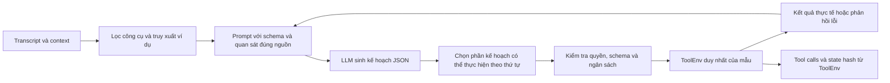

# Rà soát và cải tiến cơ chế agent

Mốc đối chiếu là commit `8cca472`; điểm BTC đã xác nhận từ người dùng là
**34,73/100**. Các điểm cao trong lịch sử benchmark nội bộ không được dùng để
khẳng định điểm leaderboard hoặc bảo đảm mục tiêu 95.

## Luồng hoạt động



Agent còn các heuristic theo miền ứng dụng trong `react_loop.py` và `prompt.py`.
Đợt sửa này củng cố đường thực thi chung để các heuristic cũng phải đi qua kiểm
tra, thay vì bổ sung quy tắc riêng cho từng mẫu public test.

## Các lỗi và thay đổi

| Cơ chế cũ | Hệ quả có thể xảy ra | Thay đổi |
|---|---|---|
| Prompt đọc/sửa frame của hàm gọi bằng `inspect`/`ctypes` | Xóa cache lời gọi, thay đổi hành vi theo cách gọi hàm | Truyền history, tools, exemplars và retriever tường minh; bỏ sửa frame |
| Prompt tự thay `llm_client.generate`, retry 6 lần và cắt chuỗi quan sát | Vượt thời gian; mất ID hoặc kết quả cần thiết; client bị biến đổi khi chạy nhiều mẫu | Client nhận thời gian còn lại; không retry ngầm; chỉ bỏ section ví dụ khi thiếu context |
| Các helper gọi `env.call()` trực tiếp | Lọt lời gọi sai schema hoặc ngoài danh sách đã cài | `GuardedToolEnv` kiểm tra mọi đường gọi trước khi tới ToolEnv gốc |
| Suy nguồn lịch sử từ các khóa như `bookings`, `products` | Lấy kết quả vé tàu cho vé máy bay, hoặc cửa hàng khác | Ghép đúng `tool_calls[i]` với `tool_results[i]`; chỉ dùng kết quả thành công |
| Cache đọc không hết hiệu lực sau ghi | Dùng danh sách hoặc trạng thái đã cũ | Xóa cache đọc của cùng app sau thao tác ghi; yêu cầu kiểm tra lại không dùng cache lịch sử |
| Gom các read lên trước trong batch | Đảo thứ tự người dùng yêu cầu; ghi trước khi biết kết quả đọc | Giữ thứ tự; dừng phần thực thi trước write đầu tiên phụ thuộc lượt read mới |
| Chọn đối tượng đầu tiên khi placeholder khớp nhiều ứng viên | Ghi đúng schema nhưng sai đối tượng/state hash | Nhánh grounding tổng quát phát hiện hòa điểm, trả lỗi để lập lại kế hoạch hoặc hỏi rõ |
| Nhánh xử lý task theo thứ tự trả về ngay | Mất mệnh đề tiếp theo của yêu cầu | Chỉ dùng đường nhanh cho yêu cầu đơn; yêu cầu nhiều mệnh đề qua vòng lặp đầy đủ |
| Schema trong prompt chỉ giữ loại dữ liệu bậc đầu | Mất ràng buộc object/array lồng nhau, format, min/max | Giữ đầy đủ schema; chuẩn hóa trường lồng nhau mà không tạo giá trị thiếu |
| Miễn dedup cho mọi `loyalty.redeem` | Có thể đổi lặp không giới hạn theo từng lượt | Chỉ cho phép số lần lặp được biểu diễn trong batch hiện tại |

Các câu lệnh ghi khác nhau vẫn được thực hiện. Các lời gọi đã thành công và trùng
hoàn toàn tiếp tục được loại bỏ. Lỗi môi trường rõ ràng được phản hồi để lập lại
kế hoạch; exception không rõ thao tác đã xảy ra hay chưa được truyền ra ngoài,
không tự gọi lại một thao tác có thể đã thay đổi state.

## Giới hạn và chi phí

- `ReActAgent` mặc định giữ 7 lượt, thêm ngân sách 28 giây và 48 lời gọi tool cho
  toàn bộ mẫu, kể cả helper. Hết ngân sách thì trả log/state hiện có và ghi thông
  báo giới hạn. Đây là kết quả có thể chưa hoàn tất yêu cầu, không phải thành công.
- Budget không ngắt cứng native kernel hoặc một `ToolEnv.call` đang chạy. HF dùng
  `max_time`, server dùng timeout và tắt retry SDK. Cần đo trên GPU đích để xác
  nhận giới hạn 30 giây của cuộc thi; hiện chưa có GPU/weights thật ở workspace.
- Full schema có thể làm prompt dài hơn. Client HF đếm token với output reserve,
  bỏ ví dụ tham khảo trước; nếu dữ liệu bắt buộc vẫn vượt cửa sổ thì báo lỗi rõ
  ràng. Server cần được cấu hình context tối đa phù hợp riêng.
- Các phase đọc/quan sát có thể cần thêm lượt LLM. Lợi ích dự kiến là giảm ghi sai;
  chưa có phép đo score/latency end-to-end để kết luận mức đánh đổi.
- Cache hết hạn theo app; tác động chéo giữa các app và một số nhánh grounding
  đặc thù vẫn cần đánh giá với ToolEnv thật. Phát hiện mơ hồ không phải bộ giải
  quyết thực thể hoàn chỉnh.
- Bộ chuẩn hóa cũ còn 771 quy tắc và prompt có nhiều heuristic/canonical exemplar.
  Đợt này không thay ASR hoặc tự gán nhãn public test. Khả năng tổng quát hóa của
  các heuristic còn lại cần được kiểm chứng trên tập đánh giá độc lập.

## Kiểm chứng

```bash
python -m unittest discover -s tests -v
python scripts/check_compliance.py
```

40 kiểm thử bao gồm 11 hồi quy cũ và các ca mới: provenance lịch sử, đọc sau ghi,
helper bị schema chặn, thứ tự read/write, task nhiều mệnh đề, ID mơ hồ, prompt
nhiều luồng, giới hạn tool/time, timeout LLM và schema lồng nhau. Một kiểm thử tạo
mô hình Qwen rất nhỏ với trọng số ngẫu nhiên để thực sự chạy Transformers offline,
kiểm tra tính xác định và từ chối context quá dài; không đánh giá năng lực tác vụ.

Chưa chạy A/B bằng ToolEnv chính thức và LLM đã huấn luyện vì thiếu dữ liệu gốc,
catalog/tool package và model local. Không có submission mới hoặc điểm BTC mới
trong đợt này. Các script ASR/evaluation/submission và artifact cũ không thuộc
commit cải tiến agent này.
