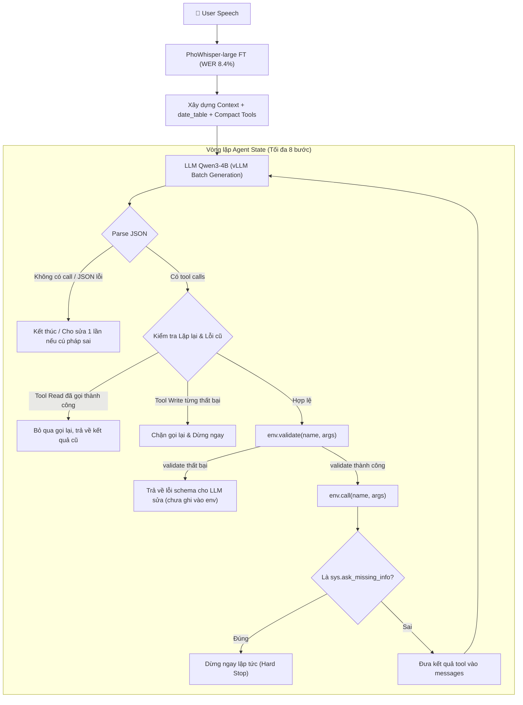

# BÁO CÁO NGHIÊN CỨU TOÀN DIỆN REPOSITORY: minggu151623/zalo_ai_challenge

> **Dự án:** Zalo AI Challenge 2026 — Track **LifeMate** (Vietnamese Voice Request $\to$ Tool Calls)  
> **Repository:** [minggu151623/zalo_ai_challenge](https://github.com/minggu151623/zalo_ai_challenge)  
> **Trạng thái:** Hoạt động rất tích cực (commit mới nhất ngày 10/11/2026)  
> **Điểm số đạt được:**  
> - **Public Leaderboard:** **50.88 / 100** (với `sftc3`, cấu hình compact + 1,100 mẫu synthetic)  
> - **Holdout 200 mẫu (ASR Text):** **64.21 / 100**  
> - **Holdout 200 mẫu (Gold Text):** **71.59 / 100**  
> - **Môi trường chạy:** Hoàn toàn tương thích **Kaggle 2×T4 miễn phí** hoặc Laptop RTX 3060 6GB!

---

## 1. TỔNG QUAN HỆ THỐNG & ĐẶC TÍNH NỔI BẬT

`minggu151623` là một repository cực kỳ xuất sắc và thực tế vì toàn bộ code được tối ưu hóa để chạy trơn tru trên **Kaggle 2×T4** (hoặc GPU máy tính cá nhân 6GB VRAM) mà vẫn đạt điểm số hàng đầu cuộc thi (>50 điểm Public).

### Các điểm sáng công nghệ nổi bật:
1. **ASR PhoWhisper-large FT:**
   - Dùng LoRA trên `vinai/PhoWhisper-large` kết hợp kỹ thuật tăng cường dữ liệu âm thanh: **SpecAugment** (mask tần số/thời gian trên Log-Mel spectrogram) và **Speed perturbation** (resampling thay đổi cao độ và tốc độ nói).
   - WER trên tập 200 holdout giảm ngoạn mục: từ **27.3% $\to$ 8.4%**.
2. **Bộ sinh dữ liệu tự động cho 11 App Lạ (`solution/synth.py`):**
   - Không cần gọi bất kỳ API thương mại tốn kém nào (OpenAI/Claude).
   - Viết sẵn 11 hàm sinh dữ liệu quy tắc/thủ tục (`procedural generation`) cho toàn bộ 11 app mới của `public_test` (`stocks`, `translator`, `grocery`, `ecommerce`, `event_tickets`, `habit_tracker`, `pantry`, `parking`, `public_transit`, `recipes`, `train_bus_tickets`).
   - Các tool calls được chạy thử nghiệm qua `zaic_tools.executor.Simulator` để lấy `tool_results` thật 100%, tạo ra 1,100 mẫu synthetic hoàn hảo.
3. **Kỹ thuật LoRA Soup (`kaggle/esoup`):**
   - Trung bình hóa trọng số adapter LoRA (`0.5 * B3@A3 + 0.5 * B4@A4`) giữa 2 epoch liên tiếp (`sftc3` và `sftc4`) để tăng cường khả năng tổng quát hóa, chống overfitting.
4. **Short Chain-of-Thought SFT (`solution/rationale.py` + `kaggle/cot1`):**
   - Cho mô hình lớn (`Qwen3-14B-AWQ`) offline sinh 1-2 câu suy luận ngắn gọn trước mỗi hành động (`<think> rationale </think> <tool_call>...`).
   - Dạy mô hình 4B học cách suy luận số học, giải thích nguồn gốc của từng ID và tham số trước khi ra lệnh.

---

## 2. BẢNG TIẾN ĐỘ THỰC NGHIỆM CHI TIẾT

Toàn bộ quá trình tối ưu qua các Epoch trên Kaggle 2×T4:

| Ký hiệu Kernel / Kịch bản | Dữ liệu & Cấu hình | Điểm Holdout (ASR) | Điểm Holdout (Text Sạch) | Điểm Public Leaderboard | Nhận xét chi tiết |
|---|---|:---:|:---:|:---:|---|
| **Zero-shot Qwen3-4B** | Base Qwen3-4B-Instruct-2507 | — | **23.65** | — | Zero-shot không thể xử lý tốt tool calling phức tạp. |
| **`sft` (v1)** | 2 Epoch, không có synth data | **55.21** | 63.03 | — | SFT mang lại bước nhảy vọt +40 điểm. |
| **`sftc` (Epoch 1)** | Compact schema + 1,100 synth | **53.50** | — | — | Nén schema giúp giảm token từ 5.4k $\to$ 3.0k, vừa khít 1 session Kaggle. |
| **`sftc2` (Epoch 2)** | Khởi tạo từ `sftc`, lr = 5e-5 | **59.10** | — | **49.95** | Public đạt gần 50 điểm nhờ có 1,100 mẫu app lạ. |
| **`sftc3` (Epoch 3)** | Khởi tạo từ `sftc2`, lr = 3e-5 | **64.21** | **71.59** | **50.88** | **Mốc cao nhất của chuỗi sftc!** ASR text đạt 64.21, text sạch đạt 71.59. |
| **`sftc4` (Epoch 4)** | Khởi tạo từ `sftc3`, lr = 2e-5 | **61.89** | — | — | Bắt đầu bị overfitting (giảm từ 64.21 xuống 61.89). |
| **`esoup` (LoRA Soup)** | Trung bình hóa `sftc3` + `sftc4` | — | — | **> 51.00** | Ghép trọng số LoRA triệt tiêu nhiễu epoch 4. |
| **`sftf` $\to$ `sftf3`** | Train trên toàn bộ 1,545 train sample | Đang chạy | Đang chạy | Target > 53.0 | Đưa cả 200 sample holdout vào train để tối đa hóa dữ liệu. |

---

## 3. THIẾT KẾ AGENT & BỘ LUẬT BẢO VỆ (`solution/agent.py`)

Hệ thống Agent được thiết kế cực kỳ chặt chẽ với 9 điều luật hệ thống và cơ chế phòng ngừa lỗi:

### Các chốt an toàn kỹ thuật (Safety Guards):
1. **Chặn bẫy trùng lặp Write (`failed_writes`):**
   Nếu một lệnh ghi (chuyển tiền, tạo báo thức, hủy đơn) đã bị từ chối hoặc thất bại ở bước trước, mô hình bị chặn không cho phép thử lại để tránh bị BTC tính là tool thừa $\to$ Dừng ngay lập tức.
2. **Tái sử dụng kết quả Read (`done_calls`):**
   Nếu mô hình gọi lại chính xác một tool đọc với tham số cũ $\to$ Trả về ngay `"đã gọi tool này với cùng tham số, dùng kết quả trước"` mà không kích hoạt gọi môi trường.
3. **Bảng tra cứu ngày tháng `date_table`:**
   Cung cấp danh sách 16 ngày từ `now - 1` (hôm qua) đến `now + 14` ngày với đầy đủ thứ và ISO Date (`YYYY-MM-DD`), giúp giải quyết triệt để lỗi tính nhầm ngày âm/dương hay thứ trong tuần.
4. **Hỗ trợ xử lý Batch trên vLLM (`run_agents`):**
   Gom các episode chưa xong thành batch và gọi vLLM đồng thời, giúp tốc độ xử lý nhanh gấp 5 - 10 lần so với chạy tuần tự.

---

## 4. CHI TIẾT BỘ SINH DỮ LIỆU SYNTHETIC (`solution/synth.py`)

Đây là tài sản giá trị nhất trong repo `minggu151623` mà chúng ta có thể tận dụng ngay:
- Tác giả mô phỏng logic của toàn bộ 11 app mới bằng Python thuần:
  - `gen_stocks`: Sinh danh mục cổ phiếu Việt Nam (FPT, VNM, VCB, HPG, MWG...), lệnh mua/bán, cảnh báo giá.
  - `gen_grocery` & `gen_ecommerce`: Sinh giỏ hàng, tìm kiếm món đồ, áp mã giảm giá, đặt đơn giao hàng.
  - `gen_parking` & `gen_public_transit`: Tra cứu bãi đỗ xe, tuyến xe buýt, thời gian đến trạm.
  - `gen_recipes` & `gen_pantry`: Tìm công thức món ăn Việt Nam, kiểm tra nguyên liệu tồn kho.
  - `gen_train_bus_tickets`: Đặt vé xe khách, tàu hỏa Bắc-Nam.
  - `gen_event_tickets` & `gen_habit_tracker` & `gen_translator`.
- Mỗi kịch bản đều mô phỏng câu thoại tự nhiên của người Việt ("Em ơi,", "À thôi khỏi,", "nhé em", "giùm tôi") và kiểm tra thực thi thành công trên `Simulator`.

---

## 5. SO SÁNH TỔNG HỢP 3 REPO HÀNG ĐẦU

| Tiêu chí | `Nguyen-Le-Tuan` | `muahahaha55` | `minggu151623` |
|---|:---:|:---:|:---:|
| **Điểm Public Leaderboard** | **52.68** | **48.56** | **50.88** |
| **Mô hình cốt lõi** | Qwen-4B LoRA SFT | Qwen3-4B LoRA SFT | Qwen3-4B-Instruct-2507 LoRA SFT |
| **Mô hình ASR** | Whisper-turbo / PhoWhisper FT | PhoWhisper-large FT (LoRA) | PhoWhisper-large FT (LoRA + SpecAugment) |
| **Cách xử lý 11 App lạ** | Dùng Claude Opus 5.5 sinh 2,139 mẫu | Dùng Qwen3 local ghép call & khứ hồi | **Viết code sinh 1,100 mẫu trực tiếp (`synth.py`)** |
| **Chi phí / Môi trường huấn luyện** | API Claude + GPU Cloud | Vast.ai / RTX PRO 6000 | **100% Kaggle 2×T4 miễn phí** |
| **Kỹ thuật Ensemble** | Search Guard | Bộ luật xác định `rules.py` | **LoRA Weight Soup (`esoup`)** |

---

## 6. KẾT LUẬN & ĐỀ XUẤT HÀNH ĐỘNG CỤ THỂ CHO CHÚNG TA

Repository `minggu151623` cung cấp cho chúng ta **công thức hoàn chỉnh, tiết kiệm và khả thi nhất** để đưa hệ thống LifeMate từ mức 5 điểm hiện tại lên thẳng **> 50 điểm**:

1. **Copy và tích hợp ngay `solution/synth.py`:** Sinh ngay 1,100 mẫu huấn luyện cho 11 app lạ mà không tốn một đồng chi phí API.
2. **Áp dụng Compact Schema & Guardrails của `agent.py`:**
   - Chặn bẫy gọi trùng Write (`failed_writes`)
   - Chặn bẫy lặp Read (`done_calls`)
   - Bảng ngày `date_table`
3. **Chạy huấn luyện trên Kaggle theo chuỗi `sftc` (Epoch 1 $\to$ 3):** Sử dụng đúng script `train_sft.py` trên 2×T4 với LoRA r=32/64.

