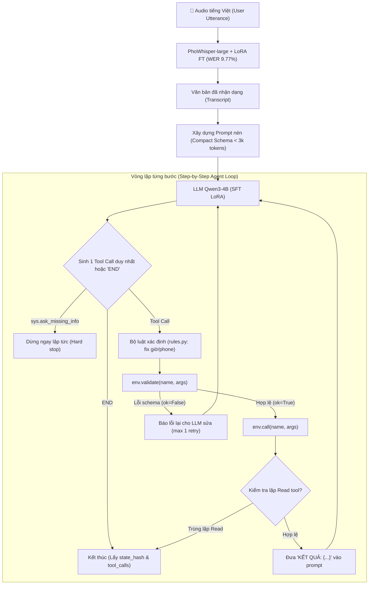

# BÁO CÁO NGHIÊN CỨU TOÀN DIỆN REPOSITORY: muahahaha55/Zalo-AI-Challenge-2026

> **Dự án:** LifeMate — Zalo AI Challenge 2026  
> **Repository:** [muahahaha55/Zalo-AI-Challenge-2026](https://github.com/muahahaha55/Zalo-AI-Challenge-2026)  
> **Trạng thái:** Hoạt động rất tích cực (commit mới nhất ngày 10/11/2026)  
> **Điểm Public Leaderboard:** **48.56 / 100** (Nộp lần 1 ngày 06/11/2026, 634/634 sample hợp lệ, 0 schema error, 100% hash replay match)

---

## 1. TỔNG QUAN HỆ THỐNG & ĐẶC ĐIỂM NỔI BẬT

Đội ngũ `muahahaha55` xây dựng hệ thống theo tiêu chuẩn khoa học thực nghiệm cực kỳ nghiêm ngặt:
- **Nguyên lý cốt lõi:** Tuyệt đối không đoán mò hay vá víu tạm bợ. Mọi cải tiến đều phải có giả thuyết, kiểm định bằng cặp mẫu (paired bootstrap test), tính khoảng tin cậy 95% (confidence intervals), và so sánh trên tập holdout chuẩn hóa.
- **Tuân thủ quy chế:** 100% offline, seed tất định, tổng tham số < 6B (LLM < 5B), thời gian xử lý trung bình 1.65s/mẫu (rất xa giới hạn 30s). Tuyệt đối không gửi dữ liệu ra bên ngoài (không dùng OpenAI/Claude API trái quy định).

### 1.1. Luồng suy luận (Inference Pipeline)


---

## 2. BẢNG TIẾN ĐỘ ĐIỂM SỐ & THỰC NGHIỆM

Toàn bộ thực nghiệm được đo trên 155 mẫu dev nội bộ (được gom cụm tránh rò rỉ các mẫu có câu thoại tương tự) và kiểm chứng trên Public Leaderboard:

| Phiên bản / Kịch bản | Điểm Dev Tổng | Exec (Thực thi) | Ask (Hỏi lại) | OOS (Từ chối) | Public Test | Nhận xét then chốt |
|---|:---:|:---:|:---:|:---:|:---:|---|
| **Zero-shot Qwen3-4B** (Text sạch) | **7.35** | 8.45 | 1.92 | 8.33 | — | Chỉ tương đương nộp rỗng (7.18đ). Zero-shot không thể giải bài toán này! |
| **SFT Qwen3-4B + PhoWhisper gốc** (WER 25.4%) | **47.75** | 44.03 | 63.46 | 50.00 | — | SFT là nguồn sinh điểm cốt lõi (+40.4đ). |
| **SFT Qwen3-4B + PhoWhisper FT** (`phowl_ft`, WER 9.8%) | **56.33** | 57.13 | 63.33 | 33.33 | — | Fine-tune ASR giảm WER từ 25.4% xuống 9.8%, tăng ngay **+8.58 điểm**! |
| **+ Luật xác định `rules.py`** | **56.98** | — | — | — | **48.56** | Nộp Public lần 1: Đạt **48.56 điểm**. Chênh lệch dev/public là **-8.42 điểm**. |
| **SFT Qwen3-4B + Text sạch (Trần LLM)** | **65.69** (có luật: 66.82) | 64.24 | 75.64 | 58.33 | — | Ngay cả khi ASR hoàn hảo 100%, LLM hiện tại vẫn mất ~34 điểm. |

---

## 3. PHÁT HIỆN SỐNG CÒN: HIỆN TƯỢNG "APP LẠ" (UNSEEN APPS)

### 3.1. Tại sao điểm Public (48.56) thấp hơn Dev (56.98) tới 8.4 điểm?
Nhóm `muahahaha55` phát hiện nguyên nhân số 1 trong dữ liệu cuộc thi:
> **65% mẫu trong `public_test` (410 / 634 mẫu) có chứa ít nhất 1 app hoàn toàn mới** (11 app mới, 34 tool mới như: `ecommerce`, `grocery`, `public_transit`, `stocks`, `recipes`, `pantry`...) mà tập `train` không hề có!

### 3.2. Thực nghiệm A4 & A4b: Giấu App để đo độ suy giảm thực tế
Nhóm thiết kế thí nghiệm giấu 6 app khỏi tập train (`flights, bike_rental, package_tracking, shopping_list, podcast_radio, loyalty`) và đo kiểm tra:
1. **Kết quả A4b (Chạy trên cùng 1 mô hình đã train `q4b_holdout`):**
   - Mẫu thuộc app **ĐÃ THẤY** trong train: **66.03 điểm**.
   - Mẫu thuộc app **LẠ / CHƯA TỪNG THẤY**: **41.93 điểm**.
   - **Khoảng cách chênh lệch:** **+24.10 điểm** (khoảng tin cậy 95%: `[+10.56, +31.41]`).
2. **Nguyên nhân mất điểm ở App lạ (Phân tích lỗi A4):**
   - **51.7% số mẫu 0 điểm:** Mô hình **gọi SAI tool** (ảo giác gọi tool quen trong train, hoặc tool không có trong catalog của mẫu đó).
   - **33.3% số mẫu 0 điểm:** Gọi đúng tool nhưng sai tham số hoặc sai ID.
   - **14.0% số mẫu 0 điểm:** Thừa hoặc thiếu lượt gọi (thường dừng lại sau khi read mà không thực hiện write).

---

## 4. GIẢI PHÁP ĐỘT PHÁ CỦA `MUAHAHAHA55` (THỰC NGHIỆM A5)

Để giải quyết bài toán app lạ mà không vi phạm luật cấm dùng API ngoài, nhóm đã xây dựng module tổng hợp dữ liệu **A5 (`src/lifemate/callgen.py`)**:

1. **Ghép đoạn call (Call Segment Transplantation):**
   - Cắt các chuỗi call hợp lệ từ các mẫu train.
   - Ghép vào môi trường của base sample chứa tool mới.
   - **Ánh xạ lại ID (Re-binding IDs):** Tìm đường dẫn thuộc tính (`events/id`, `accounts/id`) từ kết quả read thật của môi trường mới để thay thế, đảm bảo ID 100% tồn tại và state hash hợp lệ.
2. **Sinh câu nói bằng Model Local:**
   - Sử dụng `Qwen3-8B` hoặc `Qwen3.5-9B` chạy offline local trên GPU để viết lại câu khẩu lệnh tự nhiên tương ứng với chuỗi tool call.
3. **Bộ lọc khứ hồi (Round-trip verification):**
   - Dùng chính `Qwen3-4B + LoRA` chạy lại câu nói vừa sinh. Nếu agent tái hiện được đúng chuỗi tool call (`agent_ok=True`) và vượt qua luật kiểm tra câu (`text_ok=True`), mẫu đó mới được nạp vào tập SFT.
   - Thử nghiệm trên 200 mẫu đạt tỷ lệ giữ lại sạch 51% (102 mẫu hoàn hảo).

---

## 5. CÁC CHI TIẾT KỸ THUẬT QUAN TRỌNG KHÁC

### 5.1. Định dạng Schema nén (Compact Schema)
Trong `src/lifemate/prompt.py`, schema của tool được tối giản cực gọn:
```
contacts.search(query*:string[text]) # Tìm danh bạ theo tên hoặc số điện thoại
bill_payment.pay(bill_id*:string[ref=bills.id],source*:string[enum=bank|wallet]) # Thanh toán hóa đơn
sys.ask_missing_info(missing_params*:string[]) # Yêu cầu người dùng cung cấp thêm thông tin
```
- Dùng `*` biểu thị trường bắt buộc (`required`).
- Dùng `[ref=...]` cho trường cần lấy ID từ tool đọc trước đó.
- Dùng `[text]` cho tham số cho phép fuzzy match.
- Toàn bộ catalog nén xuống **< 3,000 tokens**, giảm 75% chi phí context so với JSON schema đầy đủ!

### 5.2. Bộ luật xác định `rules.py`
Mô hình LLM thường hiểu đúng hành động nhưng tính sai số học (ví dụ: "8 giờ kém 15" tính thành 20:45, hoặc ngày mai tính lệch 1 ngày).
- `rules.py` phân tích regex trên câu thoại của người dùng và `current_time`.
- Chỉ can thiệp khi:
  - Câu chỉ có **đúng 1 mốc giờ duy nhất** và không có từ dịch chuyển tương đối ("muộn thêm", "lùi 2 tiếng").
  - Tham số LLM đưa ra lệch không quá 25 giờ so với mốc tính toán.
- Kết quả: Đạt độ chính xác 100% với số điện thoại (13/13 mẫu), sửa đúng mốc giờ, tăng **+0.65 điểm** trên toàn bộ tập dev mà không gây rủi ro phá vỡ state.

### 5.3. Vòng lặp Agent an toàn tuyệt đối
- **Chặn gọi lặp Read:** Nếu cùng một hàm read được gọi lần 2 với cùng tham số $\to$ Dừng ngay (`StopReason.REPEATED_READ`), tránh vòng lặp vô tận.
- **Dừng ngay sau `sys.ask_missing_info`:** Không bao giờ gọi thêm tool sau khi đã hỏi người dùng.
- **Bắt ngoại lệ Backend:** Nếu LLM gặp CUDA OOM hoặc lỗi kết nối, agent thu hồi danh sách tool calls đã thực thi thành công từ `env.get_tool_calls()` và ghi lại thay vì crash cả chương trình (đảm bảo không bị 0 điểm vì timeout).

---

## 6. BẢNG SO SÁNH 3 HỆ THỐNG

| Tiêu chí | `Nguyen-Le-Tuan` (52.68đ) | `muahahaha55` (48.56đ) | Hiện tại của chúng ta (`zac2026-lifemate`) |
|---|---|---|---|
| **Mô hình LLM** | Qwen2.5-3B / Qwen-4B (SFT LoRA) | Qwen3-4B (SFT LoRA) | Qwen2.5-3B / 1.5B (Chưa SFT bài bản) |
| **Mô hình ASR** | Whisper-turbo / PhoWhisper FT | PhoWhisper-large FT (WER 9.8%) | PhoWhisper gốc / ASR chưa FT |
| **Xử lý App lạ** | Dùng Claude Opus 5.5 sinh 2,139 mẫu D1 từ schema catalog | Dùng Qwen3-8B/9B local ghép segment và khứ hồi | Chưa có dữ liệu huấn luyện cho 11 app lạ |
| **Quy trình suy luận** | Single-step ReAct + Search Guard | Single-step ReAct + Rules fix | Multi-step agent nhưng bị bẫy Read-only & trùng lặp Write |
| **Xử lý Thời gian** | Bảng tra cứu `date_table` 21 ngày | Luật `rules.py` can thiệp tham số | Chưa có chuẩn hóa giờ tất định |
| **Điểm Leaderboard** | 52.68 | 48.56 | ~5.00 (Do thiếu SFT và lỗi trùng lặp Write) |
