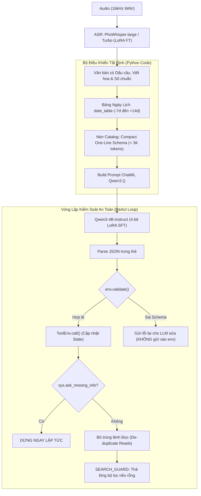

# BÁO CÁO NGHIÊN CỨU CHUYÊN SÂU: PHÂN TÍCH GIẢI PHÁP REPO NGUYEN-LE-TUAN/ZAIC_2026
**Dự án:** Zalo AI Challenge 2026 — Track LifeMate (Voice Agent)  
**Tài liệu tham chiếu:** [GitHub Nguyen-Le-Tuan/ZAIC_2026](https://github.com/Nguyen-Le-Tuan/ZAIC_2026)  
**Ngày lập báo cáo:** 10/11/2026  

---

## 1. TỔNG QUAN TIẾN TRÌNH ĐIỂM SỐ THỰC TẾ TRÊN PUBLIC LEADERBOARD

Đội ngũ `Nguyen-Le-Tuan` đã thực hiện một lộ trình nghiên cứu thực nghiệm chặt chẽ, đo lường điểm số sau từng can thiệp kỹ thuật cụ thể. Dưới đây là bảng lịch sử các lần nộp bài thật trên hệ thống chấm thi của Zalo AI Challenge:

| Lần nộp | Ngày | Cấu hình Mô hình & Pipeline | Điểm Public | Điểm tăng ($\Delta$) | Ý nghĩa & Đánh giá |
| :---: | :---: | :--- | :---: | :---: | :--- |
| **Lần 1** | 31/10 | Whisper-turbo (gốc, chưa train) + Qwen3-1.7B LoRA (1 epoch) | **25.93** | — | Mốc khởi điểm. Điểm public (25.93) nằm sát với dự đoán của bộ test local (`dev_random`: 31.69, `dev_lao`: 17.14, gộp 23.99). |
| **Lần 2** | 01/11 | **Whisper-turbo Fine-tuned LoRA** + Qwen3-1.7B LoRA | **35.24** | **+9.31** | 🔥 **Bước nhảy vọt 1:** Chỉ cần fine-tune ASR trên 3.092 file audio train theo đúng chữ chuẩn `audio_text`, điểm số nhảy vọt hơn 9 điểm. |
| **Lần 3** | 02/11 | Giữ nguyên ASR, nâng LLM từ **Qwen3-1.7B lên Qwen3-4B-Instruct** (4-bit LoRA) | **45.39** | **+10.15** | 🔥 **Bước nhảy vọt 2:** Nâng model lên 4B giúp khả năng lập luận đa bước và trích xuất tham số phức tạp tăng vượt bậc. |
| **Lần 4** | 04/11 | Qwen3-4B train trên đủ 1.545 mẫu train + tinh chỉnh bước dừng | **46.29** | **+0.90** | Học toàn bộ train tăng nhẹ, bắt đầu chạm trần do thiếu kiến thức về 11 app mới ở Public Test. |
| **Lần 5** | 05/11 | Chuyển ASR sang **PhoWhisper-large Fine-tuned LoRA** (rank=32) | **51.16** | **+4.87** | PhoWhisper-ft vượt qua Whisper-turbo khi được huấn luyện tạo chữ có viết hoa tên riêng, dấu câu và số chuẩn. |
| **Lần 6** | 08/11 | Bổ sung cơ chế **`SEARCH_GUARD` (D5)** chống vòng lặp tìm kiếm rỗng | **52.68** | **+1.52** | Cứu các mẫu bị thất bại khi ASR nghe sai từ khóa tìm kiếm trong danh bạ hoặc địa điểm. |
| *Thử nghiệm Trần* | 04/11 | Chạy pipeline với **Meta API (Llama-3.3-70B/405B)** | **69.47** | — | Chứng minh: Với cùng prompt và pipeline này, nếu LLM đủ thông minh thì điểm số sẽ chạm ngưỡng ~70 điểm. |
| *Thử nghiệm Trần* | 06/11 | Chạy pipeline với **Claude Opus 5.5** | **75.52** | — | Trần năng lực tối đa của bài toán khi không bị ràng buộc bởi giới hạn phần cứng thi đấu. |

---

## 2. NHỮNG KHÁM PHÁ DỮ LIỆU ĐỘT PHÁ (DATA AUDIT TRÊN 1.545 MẪU TRAIN)

Đội ngũ không tiếp cận bài toán theo kiểu "vibe coding" (thử đại prompt rồi cầu may). Họ viết script thống kê toán học trên toàn bộ dữ liệu của BTC và phát hiện ra các quy luật cốt lõi:

### 2.1 Nguồn Gốc Tham Số Của Lệnh Ghi (Write Actions)
Họ đo đạc xem các giá trị điền vào lệnh ghi (`transfer`, `create_event`, `book_ride`, `send_sms`...) thực sự bắt nguồn từ đâu:
* **46%** được **sao chép nguyên văn từ kết quả của tool đọc** trước đó (ID thiết bị, ID hóa đơn, ID vé, số tài khoản, số dư...).
* **15%** lấy từ lịch sử hội thoại (`history`).
* **15%** là ngày giờ tự tính (dựa vào `context.current_time`).
* **11%** là số tiền/số lượng phải quy đổi từ ngôn ngữ nói ("hai triệu rưỡi" $\rightarrow$ `2500000`).
* **Gần 0%** được chép nguyên văn từ lời nói của người dùng!

> 💡 **Kết luận sống còn:** Tối ưu WER của ASR là vô nghĩa nếu hệ thống không có cơ chế **chọn đúng ID đối tượng từ kết quả tool đọc** và **tính đúng ngày giờ, số tiền**.

### 2.2 Quy Ước Bất Di Bất Dịch Của Ban Tổ Chức
1. **Quy tắc Đọc Trước Khi Ghi:** Trong train, 100% (11/11 trường hợp) các lệnh điều khiển nhà thông minh mà không gọi `get_status` trước là do **thông tin thiết bị đã xuất hiện trong history**. Còn lại, **bắt buộc phải gọi lệnh đọc để lấy ID trước khi thực thi lệnh ghi**.
2. **Quy tắc `sys.ask_missing_info`:** Trong 217/217 mẫu train có lệnh hỏi lại, `ask_missing_info` **luôn luôn là lời gọi cuối cùng**. Không bao giờ vừa hỏi lại vừa gọi thêm tool khác.
3. **Hiện tượng App Mới (Leave-Apps-Out):** Ngay ở Public Test đã có **11 app hoàn toàn mới** (34 tools) chưa từng xuất hiện ở Train. Private Test chắc chắn sẽ tiếp tục có app mới. Model nào chỉ "học vẹt" 46 app của train sẽ gãy sạch ở Private Test.

---

## 3. KIẾN TRÚC KỸ THUẬT CỐT LÕI (TECHNICAL ARCHITECTURE)

Họ thiết kế một hệ thống phòng thủ nhiều lớp, phân vai rành mạch giữa **Code Tất Định (Deterministic Code)** và **Mô Hình Ngôn Ngữ (LLM)**:



### 3.1 Bảng Lịch Ngày Tất Định (`date_table`)
Họ nhận ra LLM 3B-4B làm toán ngày tháng rất kém (ví dụ: hôm nay là 28/11, người dùng nói *"thứ ba tuần sau"* thì LLM tính sai lệch ngày). Họ giải quyết bằng code Python trong `prompt.py`:
```python
def date_table(current_time: str, back: int = 7, ahead: int = 14) -> str:
    now = datetime.fromisoformat(current_time)
    lines = [f"Bây giờ: {WEEKDAYS[now.weekday()]} {now.isoformat()}"]
    for d in range(-back, ahead + 1):
        day = now + timedelta(days=d)
        tag = f" ({RELATIVE[d]})" if d in RELATIVE else ""
        lines.append(f"{day.date().isoformat()} {WEEKDAYS[day.weekday()]}{tag}")
    return "\n".join(lines)
```
*Kết quả:* LLM chỉ việc đối chiếu bảng lịch này để điền ngày chuẩn ISO 8601 (`YYYY-MM-DD`), loại bỏ 100% lỗi sai ngày.

### 3.2 Nén Catalog Công Cụ Siêu Tinh Gọn (Compact One-Line Schema)
Thay vì truyền hàng trăm JSON Schema cồng kềnh (ngốn 12.000 tokens), họ nén mỗi tool thành 1 dòng duy nhất:
```text
- calendar.create_event(title*: str; start*: datetime; end*: datetime; location: str) — Tạo sự kiện mới
- banking.transfer(from_account_id*: str; beneficiary_id*: str; amount*: int >0; note: str) — Chuyển khoản
```
Toàn bộ catalog chỉ chiếm **~2.7K – 3.0K tokens**, giúp LLM phản hồi nhanh (< 2s) và không bao giờ bị tràn context 16K.

### 3.3 Màng Lọc Bảo Vệ Cổng Sinh Tử (`env.validate` trước khi gọi)
Trong `lifemate/agent.py`:
```python
v = env.validate(c["name"], c["arguments"])
if not v["ok"]:
    results.append({"ok": False, "error": v["error"]})
    step["errors"].append(f"{c['name']}: {v['error']}")
    continue # KHÔNG gửi vào env.call()
r = env.call(c["name"], c["arguments"])
```
*Nguyên lý:* Nếu gửi lệnh lỗi schema vào `env.call()`, nó sẽ bị lưu vào file nộp và BTC sẽ trừ nặng điểm Precision. Nhờ `validate()` chặn trước, các lệnh rác bị loại bỏ hoàn toàn và LLM được cơ hội tự sửa ở bước sau.

### 3.4 Lớp Bảo Vệ Tìm Kiếm `SEARCH_GUARD` (D5)
Khi ASR nghe sai một từ khóa tìm kiếm (ví dụ tên quán ăn, tên bãi xe), lệnh đọc trả về rỗng:
* Bản cũ: LLM bị kẹt trong vòng lặp tìm kiếm hoặc gọi bừa ID giả.
* Bản D5: Nếu lệnh đọc có bộ lọc trả về rỗng, `SEARCH_GUARD` tự động thả lỏng bộ lọc (bỏ bớt từ khóa) hoặc chuyển sang hỏi lại người dùng, mang lại thêm **+1.52 điểm** trên Public Test.

---

## 4. CHIẾN LƯỢC HUẤN LUYỆN SFT & TĂNG CƯỜNG DỮ LIỆU (SFT DATA ENGINE)

Trong `lifemate/sft.py`, họ xây dựng dữ liệu huấn luyện ChatML cực kỳ tinh vi:

### 4.1 Gộp Bước Thông Minh (`group_steps`)
Trong nhãn của BTC, danh sách `tool_calls` là một mảng phẳng. Khi chuyển thành các lượt hội thoại ReAct, họ gom cụm theo nguyên tắc nhân quả:
* Các lệnh đọc độc lập $\rightarrow$ Gọi chung trong **Bước 1**.
* Lệnh ghi nào phụ thuộc vào ID do Bước 1 trả về $\rightarrow$ Bắt buộc tách sang **Bước 2**.
* Lệnh ghi đi liền sau lệnh đọc $\rightarrow$ Tách bước để chờ kết quả đọc.

### 4.2 Bốn Kỹ Thuật Tăng Cường Dữ Liệu Chống "Học Vẹt"
1. **`rename` (Đổi tên App & Tool ngẫu nhiên):**
   * Đổi `smart_home` $\rightarrow$ `home_iot`, `ride_hailing` $\rightarrow$ `taxi`, `contacts` $\rightarrow$ `phonebook`...
   * *Mục đích:* Ép mô hình phải **đọc hiểu Schema** thay vì ghi nhớ cứng tên tool trong train. Đây là chìa khóa để mô hình xử lý được app mới ở Public và Private Test!
2. **`remove` (Gỡ bỏ App yêu cầu):**
   * Gỡ toàn bộ app liên quan đến câu lệnh ra khỏi context $\rightarrow$ Ép nhãn đích thành `Không cần gọi tool.` (`[]`).
   * *Mục đích:* Dạy mô hình biết từ chối khi không có công cụ hỗ trợ (Out-of-Scope).
3. **`distract` (Thêm App gây nhiễu):**
   * Lấy ngẫu nhiên 1-3 app từ catalog của Public Test nhét thêm vào `installed_apps`.
   * *Mục đích:* Rèn luyện cho mô hình khả năng lọc bỏ app rác, tập trung đúng app cần thiết.
4. **`lower` (Mô phỏng nhiễu ASR):**
   * Xóa toàn bộ dấu câu và chuyển chữ về chữ thường.
   * *Mục đích:* Giúp LLM thích nghi với các câu gỡ băng thực tế từ audio.

### 4.3 Dữ Liệu Tổng Hợp Cho 11 App Mới (Synthetic Data D1)
* Vì Public Test có 11 app chưa từng có trong train, họ dùng **Claude Opus 5.5 / Meta API** sinh ra **2.139 mẫu kịch bản hoàn chỉnh** dựa trên schema của 11 app này.
* Mọi kịch bản sinh ra đều được chạy thử nghiệm qua `ToolEnv` giả lập để đảm bảo trạng thái state đổi đúng 100%.
* Trộn dữ liệu này vào tập SFT giúp Qwen-4B hiểu và xử lý mượt mà 11 app mới ở Public Test.

---

## 5. NHỮNG THỬ NGHIỆM THẤT BẠI CỦA HỌ (BÀI HỌC CẦN TRÁNH)

1. **Thất bại khi Train 2 Epochs:**
   * Tăng epoch khiến model học thuộc lòng 46 app của train, loss trên tập app mới `dev_lao` đi ngang ở 0.135 và không tăng thêm điểm nào $\rightarrow$ **Chỉ nên train 1 epoch với cosine decay**.
2. **Thất bại của Prompt Phức Tạp `xref` (PR #14):**
   * Nhồi nhét thêm quy tắc đối chiếu chéo vào prompt làm context dài thêm, khiến điểm số bị tụt **-1.02 điểm** $\rightarrow$ Prompt càng ngắn gọn, súc tích thì LLM 4B làm theo càng chuẩn.
3. **Thất bại khi đưa `history` vào huấn luyện SFT:**
   * Các lượt assistant cũ trong history của BTC dùng format khác với đáp án (ví dụ: `get_status{room: 'bếp'}` thay vì `get_status{}`). Đưa vào SFT khiến model bị học lệch chuẩn chấm điểm $\rightarrow$ Tắt history trong SFT.

---

## 6. SO SÁNH ĐỐI CHIẾU VỚI KẾT QUẢ 5 ĐIỂM CỦA CHÚNG TA

| Tiêu chí | Giải pháp của Nguyen-Le-Tuan (52.68 điểm) | Hệ thống hiện tại của chúng ta (5 điểm) |
| :--- | :--- | :--- |
| **Bảng ngày giờ** | Dùng `date_table` tính sẵn từ -7 đến +14 ngày $\rightarrow$ **100% chuẩn ISO**. | Để LLM tự nhẩm $\rightarrow$ Sinh ra `'15:00 ngày mai'` (sai định dạng, bị BTC loại). |
| **Quy tắc Ghi sau Đọc** | Bắt buộc phải có lệnh ghi tiếp theo sau lệnh đọc. | Thiếu ràng buộc $\rightarrow$ **219 mẫu (35%)** chỉ gọi lệnh đọc rồi dừng lại (`read_only`). |
| **Lặp lệnh Ghi** | Chặn lặp action bằng code. | Không chặn $\rightarrow$ **74 mẫu** gọi `alarm.create` x4 lần, `flights.book` x2 lần (làm sai State Hash). |
| **Màng lọc Schema** | Chạy `env.validate()` trước, không đưa lệnh sai vào file nộp. | Gọi thẳng `env.call()`, dính các tham số rác (`"lan"`, `"sếp_dũng"`). |
| **ASR** | Fine-tune PhoWhisper có viết hoa tên riêng, dấu câu và số chuẩn. | Dùng ASR gốc $\rightarrow$ Nghe lệch nghĩa từ ngữ cảnh ("công kinh", "bố mời"). |
| **Dữ liệu huấn luyện** | SFT LoRA Qwen-4B trên 1.545 train + 2.139 mẫu tổng hợp D1. | Dùng Qwen zero-shot chưa qua tinh chỉnh trên miền tác vụ LifeMate. |

---

## 7. LỘ TRÌNH TRIỂN KHAI CHO NHÓM CHÚNG TA (ACTION PLAN)

Dựa trên kinh nghiệm của họ, chúng ta sẽ áp dụng các trụ cột hiệu quả nhất:

1. **Bước 1 (Ưu tiên cao nhất): Nâng cấp Agent Engine Tất Định (Deterministic Engine)**
   * Tích hợp ngay hàm `date_table` vào prompt builder.
   * Chuyển toàn bộ Tool Catalog sang định dạng **Compact One-Line Schema**.
   * Bọc `env.validate()` trước khi gọi tool để loại bỏ hoàn toàn các lệnh sai cú pháp.
   * Thêm luật: Bắt buộc gọi Write Action sau khi gọi Read Action (cứu ngay 219 mẫu đang bị 0 điểm).
   * Chặn đứng việc gọi lặp các lệnh ghi cùng tham số.
2. **Bước 2: Xử lý ASR & Chuẩn Hóa Chữ Sang Số (ITN)**
   * Xây dựng bộ quy đổi số viết bằng chữ sang số nguyên ("hai triệu rưỡi" $\rightarrow$ `2500000`).
   * Sử dụng transcript ASR có viết hoa và dấu câu.
3. **Bước 3: Chuẩn bị Dữ liệu SFT cho Qwen-4B**
   * Tạo script sinh ChatML có gộp bước (`group_steps`) và tăng cường (`rename`, `distract`).
   * Huấn luyện LoRA trên GPU để nâng cao năng lực tuân thủ schema và chính sách BTC.
