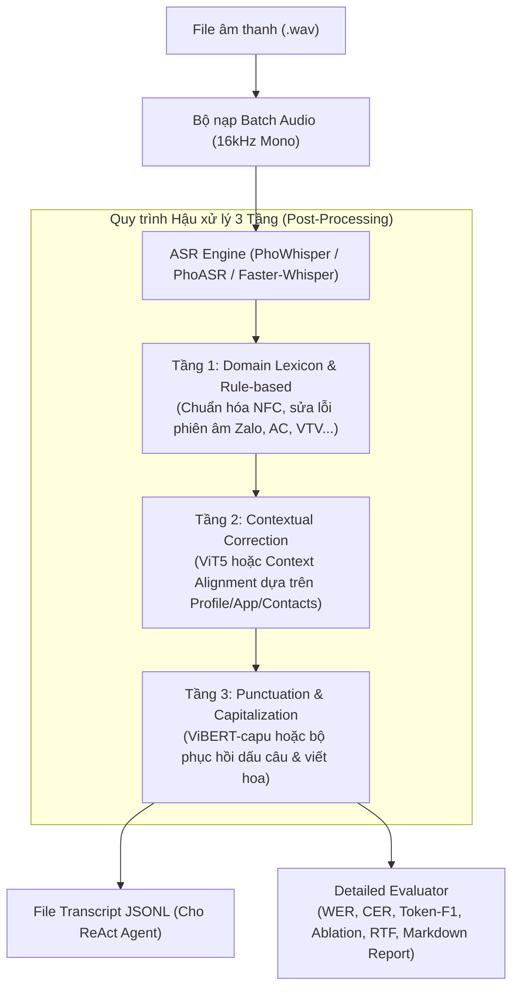

# ZAC 2026 LifeMate — Speech-to-Text (ASR) & Multi-tier Post-Processing

Tài liệu thiết kế kiến trúc, cấu hình môi trường `.env`, tối ưu hóa xử lý Batch trên GPU và hướng dẫn triển khai trên **Kaggle** cho module Âm thanh (Thành viên 3).

---

## 1. Sơ đồ Kiến trúc Pipeline



---

## 2. Cấu hình Môi trường `.env`

Tất cả các tham số được quản lý tập trung qua file `.env` tại thư mục gốc của project (hoặc biến môi trường hệ thống).

| Biến môi trường | Mặc định | Tùy chọn / Mô tả |
| :--- | :--- | :--- |
| `ASR_ENGINE` | `phowhisper` | `phowhisper`, `phoasr`, `faster_whisper` |
| `ASR_MODEL_NAME_OR_PATH` | `vinai/phowhisper-medium` | `vinai/phowhisper-small`, `vinai/phowhisper-medium`, `vinai/phoasr-base`... |
| `DEVICE` | `auto` | `cuda`, `cpu`, `auto` |
| `TORCH_DTYPE` | `float16` | `float16`, `bfloat16`, `float32` |
| `ASR_BATCH_SIZE` | `16` | Kích thước batch xử lý song song trên GPU (Kaggle nên đặt `16` hoặc `32`) |
| `ENABLE_LEXICON_CORRECTION` | `true` | **Tầng 1:** Bật/Tắt từ điển nghiệp vụ và sửa lỗi phiên âm |
| `ENABLE_CONTEXTUAL_CORRECTION`| `false` | **Tầng 2:** Bật/Tắt sửa lỗi ngữ cảnh bằng ViT5 |
| `CONTEXT_MODEL_NAME_OR_PATH` | `VietAI/vit5-base` | Mô hình ngôn ngữ cho Tầng 2 |
| `ENABLE_PUNCTUATION_RESTORATION`| `false` | **Tầng 3:** Bật/Tắt phục hồi dấu câu và viết hoa |
| `PUNCTUATION_MODEL_NAME_OR_PATH`| `fptai/vibert-capu`| Mô hình phục hồi dấu câu cho Tầng 3 |
| `DATA_ROOT` | *(Đường dẫn dữ liệu)* | Thư mục chứa tập `train/` và `public_test/` |
| `OUTPUT_DIR` | `data/MultiASR_Results` | Thư mục xuất file transcript và báo cáo đánh giá |

---

## 3. Các Tầng Hậu Xử Lý (Post-Processing)

### Tầng 1: Domain Lexicon & Rule-based Normalization (`LexiconPostProcessor`)
* **Mục tiêu:** Chuẩn hóa Unicode NFC, xóa khoảng trắng thừa, sửa các lỗi nhận diện phiên âm sai đặc thù của miền ứng dụng LifeMate:
  * Tên ứng dụng mượn: *"za lo"* $\rightarrow$ `Zalo`, *"za lo pay"* $\rightarrow$ `ZaloPay`, *"mo mo"* $\rightarrow$ `MoMo`.
  * Từ mượn: *"bút vé"* $\rightarrow$ `book vé`, *"ai xi / ây xi"* $\rightarrow$ `AC` (điều hòa).
  * Kênh TV & Phim: *"vê tê vê 3"* $\rightarrow$ `VTV3`, *"ét xê tê vê 9"* $\rightarrow$ `SCTV9`, *"thông ngày nắng về"* $\rightarrow$ `Thương ngày nắng về`.
  * Tên riêng trong đề: `Kevin Walsh`, `Kevin Welsh`, `Bác Ba`, `Bác Bằng`, `Sếp Dũng`.
* **Tốc độ:** $< 0.1$ ms/mẫu trên CPU, không tiêu tốn VRAM.

### Tầng 2: Contextual Correction (`ContextualPostProcessor`)
* **Mục tiêu:** Sửa các từ nhận diện nhầm nhưng có thể suy luận chính xác từ ngữ cảnh.
* **Cơ chế:** Sử dụng mô hình `VietAI/vit5-base` (Seq2Seq) kết hợp với các gợi ý thực thể ngữ cảnh (`context_hints`) được trích xuất từ `user_profile` (tên, thành phố), `installed_apps` và hội thoại trước đó.
* Hỗ trợ cơ chế **Heuristic Context Alignment** dự phòng cực nhanh nếu không tải weights ViT5.

### Tầng 3: Punctuation & Capitalization Restoration (`PunctuationPostProcessor`)
* **Mục tiêu:** Khôi phục dấu câu (chấm, phẩy, hỏi chấm) và viết hoa ký tự đầu câu / thực thể.
* **Cơ chế:** Tích hợp pipeline `fptai/vibert-capu` (hoặc rule-based thông minh tự động nhận diện từ nghi vấn *"không"*, *"nhỉ"*, *"gì"*, *"nào"* $\rightarrow$ `?`).

---

## 4. Hệ Thống Đánh Giá Chi Tiết (`evaluate.py`)

Hệ thống tính toán toàn bộ các chỉ số chất lượng:
1. **WER (Word Error Rate):** Kèm chi tiết số lỗi Thay thế ($S$), Bỏ sót ($D$), Chèn thêm ($I$) trên tổng số từ ($N$).
2. **CER (Character Error Rate):** Tỷ lệ lỗi ở cấp độ ký tự.
3. **Token-F1 Score:** Chuẩn hóa Unicode NFC, lowercase, tính toán F1 đa tập theo đúng công thức ZAC 2026.
4. **Exact Match (EM):** Tỷ lệ câu khớp chính xác 100%.
5. **Ablation Study:** So sánh trực quan hiệu quả của từng tầng:
   $$\text{Raw ASR} \longrightarrow \text{+ Tầng 1} \longrightarrow \text{+ Tầng 2} \longrightarrow \text{+ Tầng 3}$$
6. **Báo cáo tự động:**
   * Xuất file Markdown: `data/MultiASR_Results/..._eval_report.md`
   * Xuất file JSON metrics: `data/MultiASR_Results/..._metrics.json`

---

## 5. Hướng Dẫn Đẩy Lên Git & Chạy Trên Kaggle GPU

### Bước 1: Đẩy mã nguồn lên Git từ máy cá nhân
```bash
git add .
git commit -m "feat(asr): PhoWhisper batching & 3-tier post-processing pipeline"
git push origin main
```

### Bước 2: Thiết lập trên Kaggle Notebook
1. Mở Kaggle, tạo một **New Notebook**.
2. Tại phần **Settings** (bên phải giao diện Kaggle):
   * **Accelerator:** Chọn **GPU T4 x2** hoặc **GPU P100**.
   * **Internet:** Bật **ON** (để clone repo và tải weights từ HuggingFace).
3. Đính kèm bộ dữ liệu cuộc thi (Dataset chứa `train+public_test` hoặc tải từ link BTC).

### Bước 3: Chạy các lệnh sau trong các cell Notebook

#### Cell 1: Clone repo và cài đặt thư viện
```python
!git clone https://github.com/<your-username>/zac2026-lifemate.git
%cd zac2026-lifemate
!pip install -r requirements.txt
```

#### Cell 2: Cấu hình biến môi trường `.env` trên Kaggle
```python
import os

# Cấu hình đường dẫn dữ liệu trên Kaggle
os.environ["DATA_ROOT"] = "/kaggle/input/zalo-ai-challenge-2026/train+public_test"
os.environ["OUTPUT_DIR"] = "/kaggle/working/MultiASR_Results"

# Chọn Engine và tối ưu Batch trên GPU T4/P100
os.environ["ASR_ENGINE"] = "phowhisper"
os.environ["ASR_MODEL_NAME_OR_PATH"] = "vinai/phowhisper-medium"
os.environ["ASR_BATCH_SIZE"] = "16"
os.environ["DEVICE"] = "cuda"

# Bật/Tắt các tầng Post-Processing
os.environ["ENABLE_LEXICON_CORRECTION"] = "true"
os.environ["ENABLE_CONTEXTUAL_CORRECTION"] = "false"  # Bật nếu muốn thử ViT5
os.environ["ENABLE_PUNCTUATION_RESTORATION"] = "false" # Bật nếu muốn thử ViBERT
```

#### Cell 3: Chạy đánh giá chi tiết trên tập Benchmark (200 mẫu)
```python
!python scripts/run_asr_pipeline.py --mode benchmark
```
*Kết quả sẽ hiển thị bảng chỉ số WER, CER, Token-F1 và sinh báo cáo Markdown chi tiết.*

#### Cell 4: Chạy gỡ băng toàn bộ 634 mẫu `public_test` để chuẩn bị nộp bài
```python
!python scripts/run_asr_pipeline.py --mode public_test --batch_size 16
```
*File kết quả `public_test_phowhisper_for_agent.jsonl` sẽ được tạo sẵn trong thư mục output.*

#### Cell 5: Đưa kết quả ASR vào ReAct Agent để sinh file nộp bài `submission.jsonl`
```python
!python scripts/run_with_asr.py \
    --make_submission \
    --asr_dir /kaggle/working/MultiASR_Results \
    --asr_model phowhisper \
    --output_file /kaggle/working/submission.jsonl
```
*(File nộp bài `submission.zip` sẽ tự động được đóng gói chuẩn quy cách của BTC).*
